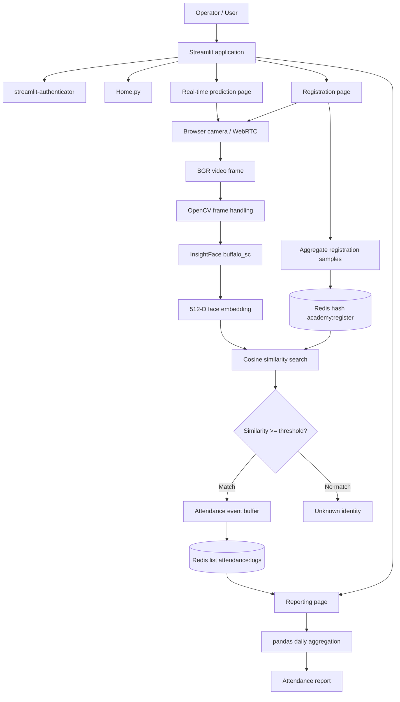
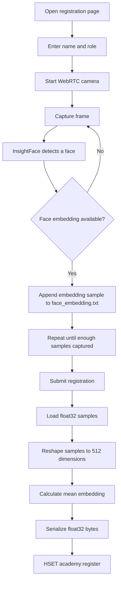
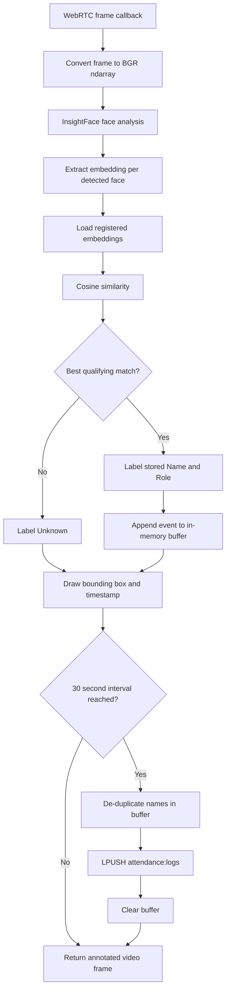
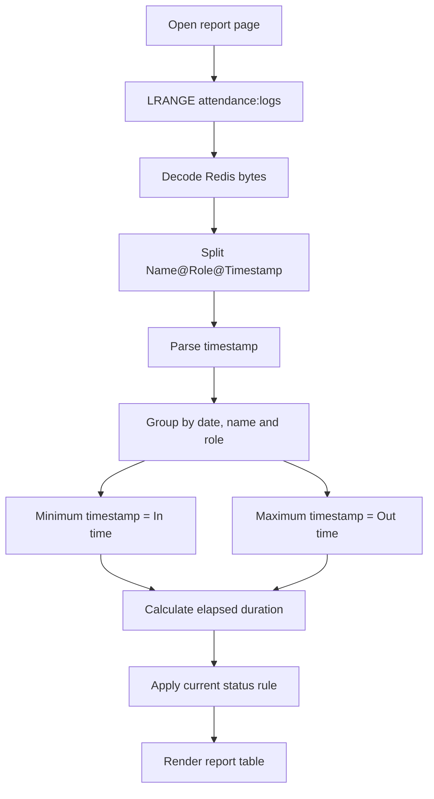

<div align="center">
  
  <h1>📸 Face Attendance System</h1>
  <p><strong>A Streamlit prototype for face registration, live face matching, Redis-backed attendance events, and daily reporting.</strong></p>
  <p>
    
    
    
    
    
    
  </p>
  <p>
    <a href="https://github.com/Brajesh31/attendance-system-app/actions/workflows/ci.yml"></a>
    <a href="https://github.com/Brajesh31/attendance-system-app/actions/workflows/docs-quality.yml"></a>
    <a href="https://github.com/Brajesh31/attendance-system-app/actions/workflows/security.yml"></a>
    <a href="https://github.com/Brajesh31/attendance-system-app/commits/main"></a>
    <a href="https://github.com/Brajesh31/attendance-system-app/stargazers"></a>
    <a href="https://github.com/Brajesh31/attendance-system-app/network/members"></a>
    <a href="https://github.com/Brajesh31/attendance-system-app/issues"></a>
  </p>
  <p><a href="#-overview">Overview</a> · <a href="#-architecture">Architecture</a> · <a href="#-quick-start">Quick start</a> · <a href="docs/README.md">Full documentation</a></p>
</div>

> [!CAUTION]
> **This is an educational prototype, not a production attendance or identity-verification system.** Facial embeddings are biometric data. Do not process real people without an appropriate legal basis, informed consent, access control, retention/deletion rules, security review, and a documented alternative for people who cannot or do not wish to use face recognition. The committed `config.yaml` includes a sample account identity and a sample cookie signing key. Replace these immediately before any shared use. Never use the sample password/hash or key in a deployed environment.

## 🧭 Overview

Face Attendance System is a Python application built around Streamlit's multipage interface. It uses InsightFace's `buffalo_sc` model to produce face embeddings, compares captured embeddings with registered vectors using cosine similarity, stores registration vectors and attendance events in Redis, and derives daily summaries with pandas.

The project is organized around four user-facing screens:

| Screen | File | Purpose |
|---|---|---|
| Login and landing | `Home.py` | Loads the app shell and authentication-facing content |
| Real-time prediction | `pages/1_Real_Time_Prediction.py` | Captures webcam frames and performs face matching |
| Registration | `pages/2_Registration_form.py` | Captures samples and saves an averaged embedding |
| Reports | `pages/3_Report.py` | Displays registered data, raw event logs, and daily rollups |

Supporting modules include `auth.py` for Streamlit authentication configuration, `face_rec.py` for face analysis and Redis interaction, and `upload_logs.py` for importing a local simulated log file.

## ✨ Capabilities and implementation status

| Area | Current state | Important qualification |
|---|---|---|
| Streamlit multipage UI | ✅ Present | Pages are discovered from the `pages/` directory |
| Authentication integration | ⚠️ Present, needs review | Uses `streamlit-authenticator` and committed sample YAML |
| Camera capture | ✅ Present in page code | Requires browser camera permission and WebRTC-compatible transport |
| Face embedding extraction | ✅ Present in shared module | InsightFace `buffalo_sc`, 512-dimensional vectors expected |
| Registration vector aggregation | ✅ Present | Saves the mean of captured embeddings |
| Redis registration storage | ✅ Present | Hash `academy:register`, field `Name@Role` |
| Cosine-similarity matching | ✅ Present | Threshold is currently passed as 0.5 |
| Periodic attendance event writes | ✅ Present | Current callback buffers frames and attempts a write every 30 seconds |
| Attendance reports | ⚠️ Present, defects identified | Report code references a misspelled function name mismatch |
| CSV/export workflow | ❌ Not evidenced | No export action is present in the inspected page |
| Liveness / anti-spoofing | ❌ Not implemented | A face match is not proof of a live, authorized person |
| Consent and retention management | ❌ Not implemented | Required before real biometric deployment |
| Automated test suite | ❌ Not configured | No test framework or tests currently exist |
| Production deployment | ⚠️ Partial guidance only | Apache reverse-proxy example exists; no verified production setup |

## 🧱 Technology stack

| Component | Library / asset | Role |
|---|---|---|
| Language | Python | Application logic |
| UI and routing | Streamlit | Multipage application and session state |
| Web camera transport | streamlit-webrtc, aiortc/av dependencies | Browser camera frames and frame callback |
| Face detection and embeddings | InsightFace | Face analysis and feature vectors |
| Model execution | ONNX Runtime | CPU execution provider configured in code |
| Image processing | OpenCV | Frame conversion, boxes, annotations |
| Numerical operations | NumPy | Embedding arrays and serialization |
| Similarity search | scikit-learn | Cosine similarity |
| Tabular processing | pandas | Registration lookup and daily reports |
| Persistence | Redis | Embeddings and attendance event list |
| Authentication | streamlit-authenticator | Login and cookie-based auth integration |
| Configuration | YAML and environment example | Auth sample and connection setup conventions |

Dependencies are listed in `requirements.txt`. The repository does not pin exact package versions, so identical installs are not guaranteed across time or platforms. See [Dependency and compatibility notes](docs/dependencies.md).

## 🏗️ Architecture

The app is a Streamlit process that reads registered embeddings from Redis, extracts embeddings from WebRTC frames using InsightFace, computes cosine similarity, and writes recognized events back to Redis. Reporting reads those event strings and groups them by date, name, and role.



**Data flow is schematic.** It shows the intended feature path, not a guarantee that all page paths currently execute without defects. The known function-name mismatch in reporting and the configuration defects are documented in [Known issues](docs/known-issues.md).

### Registration flow



### Recognition and attendance flow



### Reporting flow



## 🗃️ Redis data contracts

| Redis key | Type | Field/value representation | Used by |
|---|---|---|---|
| `academy:register` | Hash | Field: `Name@Role`; value: serialized float32 vector bytes | Registration and recognition |
| `attendance:logs` | List | `Name@Role@Timestamp` string | Recognition, import script, reports |

The serialized embedding is expected to contain 512 float32 values. The string delimiter `@` is part of the current contract, so names or roles containing that character can break parsing. These formats are legacy implementation details, not a recommended long-term schema. See [Data model](docs/database.md).

## 🚀 Quick start

### Prerequisites

- Python 3.10 or newer. The repository contains Python 3.10 and 3.11 bytecode caches, but no formal supported-version matrix.
- Redis accessible from the application process.
- Webcam and a browser that grants camera access.
- OS packages and hardware compatible with OpenCV, InsightFace, and ONNX Runtime.
- Git.

### 1. Clone the repository

```bash
git clone https://github.com/Brajesh31/attendance-system-app.git
cd attendance-system-app
```

### 2. Create a virtual environment

```bash
python -m venv .venv
```

Activate it:

```bash
# Windows PowerShell
.venv\Scripts\Activate.ps1

# macOS / Linux
source .venv/bin/activate
```

### 3. Install dependencies

```bash
python -m pip install --upgrade pip
python -m pip install -r requirements.txt
```

The dependency file is unpinned. For reproducible deployments, create and review a platform-specific lock/constraints file rather than assuming that the latest transitive dependencies will remain compatible.

### 4. Configure private credentials

The checked-in `config.yaml` is a sample and currently contains a human identity/email, a password hash for a trivial example password, and a cookie signing key. Do not deploy it. Create a private configuration file from an approved template, keep it out of Git, use a unique strong password hash and a cryptographically random cookie key, and restrict file permissions.

Redis host, port, and password are hard-coded as placeholders in `face_rec.py` and `upload_logs.py`. The committed `.env.example` is illustrative only: the current application does not load it. Do not expect changing that file to alter runtime connection behavior. A source-code configuration refactor is required.

### 5. Start Redis

Start a local Redis instance or provision a private managed instance. Bind Redis to a private interface, enable authentication and TLS where supported, and do not expose port 6379 to the public internet.

### 6. Start Streamlit

```bash
streamlit run Home.py
```

Open the URL printed by Streamlit, usually <http://localhost:8501>.

### 7. Validate the workflow with synthetic identities

1. Log in using a locally configured test account.
2. Open Registration and test with a consenting synthetic/test identity.
3. Capture several usable samples in adequate lighting.
4. Submit and verify that the expected hash entry appears in a disposable Redis database.
5. Open Real-Time Prediction and verify that recognized and unknown labels behave as expected.
6. Confirm event writes in the test Redis list.
7. Open Reports and validate date grouping and duration calculations.

Do not test on employees, students, or visitors without documented authorization and consent. Never commit captured camera frames or embeddings.

## ⚙️ Configuration reference

| Setting | Current source | Description | Status |
|---|---|---|---|
| Authentication credentials | `config.yaml` | Streamlit authenticator user configuration | Sample only; replace |
| Cookie name | `config.yaml` | Authenticator cookie name | Sample only |
| Cookie signing key | `config.yaml` | Signs authentication cookie | Must be unique secret |
| Cookie expiry | `config.yaml` | Days before cookie expiry | Review policy |
| Redis host | `face_rec.py`, `upload_logs.py` | Redis endpoint | Placeholder in source |
| Redis port | Same | TCP port | Placeholder in source |
| Redis password | Same | Redis authentication | Placeholder in source |
| Model root | `face_rec.py` | `insightface_model` | Relative path |
| Model name | `face_rec.py` | `buffalo_sc` | Bundled local assets |
| ONNX provider | `face_rec.py` | CPUExecutionProvider | CPU configured |
| Detection size | `face_rec.py` | 640 × 640 | Hard-coded |
| Detection threshold | `face_rec.py` | 0.5 | Hard-coded |
| Matching threshold | Page call | 0.5 | Hard-coded in page call |
| Attendance write interval | Live page | 30 seconds | Hard-coded |

See [Configuration and secrets](docs/configuration.md).

## 🧪 Quality checks

There is no configured automated test suite, linter, formatter, or dependency lockfile in the current repository. Start with syntax checks:

```bash
python -m compileall -q Home.py auth.py face_rec.py upload_logs.py pages
```

This catches syntax/bytecode compilation problems only. It does not validate Redis connectivity, model availability, Streamlit session flow, WebRTC behavior, camera permissions, face-recognition accuracy, or report correctness.

A useful test plan should cover: empty Redis, malformed embedding values, no face detected, multiple faces, unknown identities, duplicate detections, Redis outage, no camera permission, invalid timestamps, empty logs, timezone boundaries, repeated registrations, and false-match/false-reject evaluation. See [QA strategy](docs/qa.md).

## 🔐 Privacy, safety, and security

Face embeddings are sensitive biometric identifiers. A cosine-similarity match is probabilistic and can be wrong. This application has no demonstrated liveness/anti-spoofing control, model performance evaluation, retention enforcement, role-based report authorization, or auditable consent workflow.

Before any real-world pilot:
- establish a lawful basis and obtain clear, documented, revocable consent where required;
- provide a meaningful non-biometric attendance alternative;
- conduct a privacy impact assessment and define purpose limitation;
- minimize collection and retention, and implement verified deletion;
- encrypt traffic to Redis and restrict it to a private network;
- secure authentication configuration and rotate all sample secrets;
- limit who can register, view, export, or delete biometric records;
- log administrative access without logging raw embeddings or face images;
- test demographic performance, false acceptance, false rejection, and spoofing;
- document model and asset licenses and applicable terms.

See [SECURITY.md](SECURITY.md), [Data privacy](docs/data-privacy.md), and [Threat model](docs/threat-model.md).

## ⚠️ Known limitations

The repository currently has several code-level issues that should be resolved before relying on the system:
- `pages/3_Report.py` calls `face_rec.retrieve_data`, but `face_rec.py` defines `retrive_data` (different spelling).
- `Home.py` imports authentication, while `auth.py` itself invokes login and renders content at import time. This creates duplicated/session-order-sensitive behavior that needs runtime testing.
- `pages/2_Registration_form.py` has adjacent role string literals without a comma, causing two labels to concatenate.
- `RegistrationForm.save_data_in_redis_db` expects a local `face_embedding.txt` and uses process working-directory state. Concurrent sessions can collide on that filename.
- The live recognition callback uses process-global mutable state and a global timer. Multi-session behavior and thread safety are not established.
- Attendance events use a delimiter-based string without schema validation or escaping.
- The report derives first/last seen from periodic sightings. It does not prove actual arrival/departure, and duration/status can be misleading.
- The status rule marks a person present when the observed span is at least 60 seconds. This is a prototype heuristic, not an institutional attendance policy.
- The report page's registration refresh path calls the mismatched retrieval function.
- Credentials and Redis connection settings are not wired through the provided environment example.

See [Known issues register](docs/known-issues.md) and [Risk register](docs/risk-register.md).

## 🖼️ Visual assets and screenshots

The repository includes a generated technical SVG illustration under `docs/assets/`. It is not a screenshot of a running application. Genuine screenshots of the login, registration, recognition, and reports pages should be captured only after running the app with synthetic data and a disposable Redis instance. Do not publish identifiable faces, embeddings, emails, or real attendance logs. See [Screenshot policy](docs/demo/README.md).

## 🤝 Contributing

Read [CONTRIBUTING.md](CONTRIBUTING.md) before making changes. Use synthetic data, isolate Redis, run syntax checks, and document data-contract changes. Security and privacy changes must include threat-model and retention implications. Templates for bugs, feature proposals, privacy concerns, and pull requests are in `.github/`.

## 🗺️ Roadmap

1. Replace committed sample identity and cookie secrets; add secure secret loading.
2. Externalize Redis configuration and validate startup settings.
3. Fix known function/name/form issues and isolate per-session registration data.
4. Define a versioned Redis schema with structured events and timestamps.
5. Add tests for recognition matching, serialization, event parsing, and reporting.
6. Define consent, retention, deletion, alternative attendance, and audit workflows.
7. Evaluate recognition accuracy and spoof-resistance before considering any real pilot.
8. Add monitoring, operational runbooks, reproducible dependencies, and deployment validation.

See [ROADMAP.md](ROADMAP.md).

## 📚 Documentation map

| Document | Scope |
|---|---|
| [Documentation hub](docs/README.md) | Complete guide index |
| [Project structure](docs/project-structure.md) | File-by-file repository map |
| [Operations](docs/operations.md) | Runbooks and maintenance |
| [Risk register](docs/risk-register.md) | Prioritized risks |
| [Glossary](docs/glossary.md) | Domain terminology |
| [Product overview](docs/product-overview.md) | Goals, users, boundaries, requirements |
| [Architecture](docs/architecture.md) | Components and runtime boundaries |
| [System design](docs/system-design.md) | Recognition and event design |
| [Data flow](docs/data-flow.md) | Registration, match, report lifecycle |
| [Redis data model](docs/database.md) | Key types and serialization contracts |
| [Interfaces](docs/api.md) | Streamlit page and Redis interface |
| [Configuration](docs/configuration.md) | Runtime settings and secret handling |
| [Installation](docs/installation.md) | Local environment |
| [Development](docs/development.md) | Contributor workflow |
| [Deployment](docs/deployment.md) | Reverse proxy and infrastructure |
| [Security](docs/security-review.md) | Threats and controls |
| [Privacy](docs/data-privacy.md) | Biometric data lifecycle |
| [QA plan](docs/qa.md) | Manual and automated validation |
| [Troubleshooting](docs/troubleshooting.md) | Diagnostics and recovery |
| [Known issues](docs/known-issues.md) | Confirmed source gaps |
| [Risk register](docs/risk-register.md) | Prioritized product and security risks |
| [Glossary](docs/glossary.md) | Domain terminology |
| [Diagrams](docs/diagrams/README.md) | Mermaid references |
| [Demo captures](docs/demo/README.md) | Real screenshot capture policy |

## 📄 License

The project includes an MIT license. See [LICENSE](LICENSE). Model weights, pretrained assets, and third-party packages may carry separate licenses or usage conditions. Review those terms independently before redistribution or commercial use.

<p align="center"><sub>Documentation reflects the inspected repository, not an assertion of production readiness.</sub></p>

Last updated: 2026-11-21 09:23 UTC
