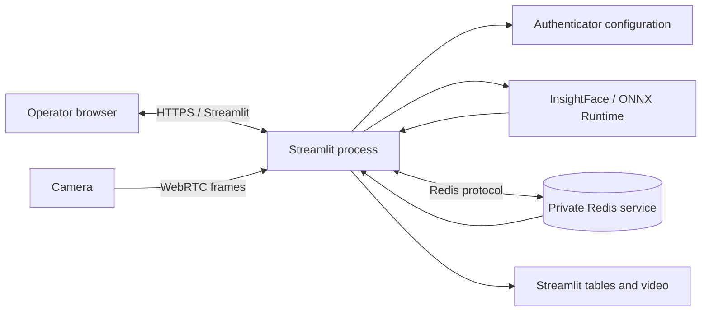
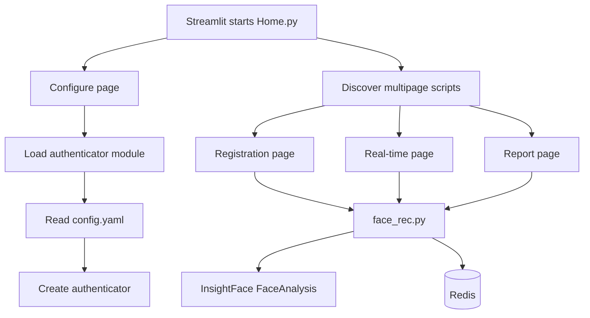

# 🏗️ Architecture

## Architectural style

The repository is a single Streamlit application process with a shared Python recognition module and an external Redis data service. Streamlit discovers pages from `pages/`; the shared module `face_rec.py` owns model initialization, vector search, Redis reads/writes, and helper classes.

## Component inventory

| Component | File | Responsibility | Notes |
|---|---|---|---|
| Application shell | `Home.py` | Sets page configuration and displays authenticated landing content | Imports `auth` and handles session state |
| Authenticator | `auth.py` | Loads YAML and constructs Streamlit authenticator | Performs login as an import-time side effect |
| Recognition core | `face_rec.py` | Redis client, InsightFace model, similarity, event buffer, registration | Contains hard-coded placeholder Redis values |
| Live page | `pages/1_Real_Time_Prediction.py` | Reads registered vectors and handles WebRTC frames | Uses global timer and prediction object |
| Registration page | `pages/2_Registration_form.py` | Collects identity fields and face samples | Uses shared working-directory file |
| Report page | `pages/3_Report.py` | Reads logs and computes daily summaries | Calls a function name not defined in the current core |
| Log importer | `upload_logs.py` | Pushes simulated records to Redis | Expects `simulated_logs.txt`, not present in tracked tree |
| Model assets | `insightface_model/models/buffalo_sc/` | ONNX detector and recognition assets | Review upstream licensing and redistribution terms |

## System context

## Runtime component flow

## Dependency boundaries

- Streamlit owns page execution and UI state.
- streamlit-webrtc provides browser-to-server video frames.
- InsightFace and ONNX Runtime perform face analysis.
- OpenCV adapts frames and renders bounding boxes.
- NumPy stores and reshapes feature vectors.
- scikit-learn computes cosine similarity.
- Redis stores vectors/events.
- pandas parses events and groups daily reports.

## State and concurrency

The present implementation creates module-level model and Redis objects, and the live page creates a global prediction instance and timer. Registration writes to a fixed local file named `face_embedding.txt`. These choices can cause cross-session interference or data races under concurrent users. They are acceptable only as known prototype constraints, not as a multi-user deployment architecture.

## Failure boundaries

| Failure | Affected area | Expected behavior to design |
|---|---|---|
| Redis unavailable | Registration, recognition, reports | Show service-unavailable state; do not silently claim success |
| Model assets missing | Recognition and registration | Fail startup with an actionable model path message |
| Camera permission denied | WebRTC pages | Explain browser permission and offer non-camera alternative |
| No face found | Registration | Prompt to adjust framing, do not write an empty vector |
| Invalid vector bytes | Search | Reject malformed record and record a sanitized diagnostic |
| Malformed event string | Reporting | Quarantine invalid row rather than failing all reports |
| Auth config missing | App startup | Stop with secure configuration guidance |

## Architecture decisions

See [ADR 0001: Streamlit and Redis prototype](adr/0001-streamlit-redis-prototype.md). The architecture should be reconsidered before multi-tenant or high-impact deployment.
