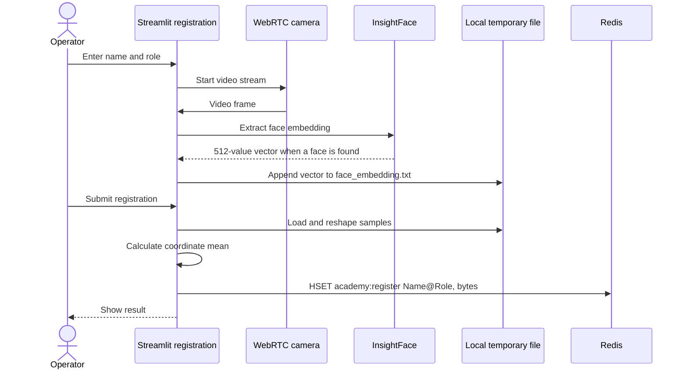
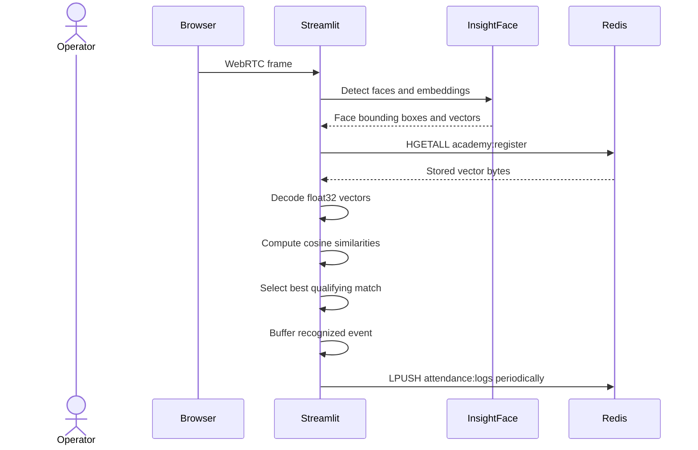
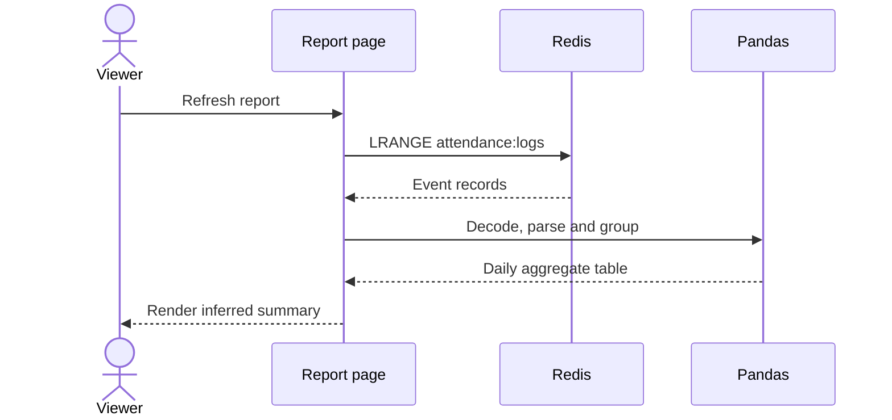

# 🔄 Data flow and lifecycle

## Registration

The temporary file is a concurrency and privacy risk. It is written in the process working directory and is not scoped to an individual browser session. A safer design uses per-session memory or isolated temporary storage with explicit cleanup.

## Recognition

## Report

## Data inventory and sensitivity

| Data | Source | Current location | Sensitivity |
|---|---|---|---|
| Face image frame | User camera | In-memory frame callback | High |
| Face embedding | InsightFace model | Temporary file and Redis hash | Very high, biometric |
| Name and role | Registration input | Redis hash field | Personal data |
| Attendance timestamp | Recognition callback | Redis list | Personal/behavioral |
| Authentication user/email | YAML configuration | `config.yaml` | Personal and account data |
| Cookie signing key | YAML configuration | `config.yaml` | Secret |

## Lifecycle gaps

The code does not implement a consent record, purpose/expiry metadata, deletion request path, export approval, correction workflow, or proof of deletion. Redis backups and replicas can also preserve records beyond deletion from the primary keyspace. Define lifecycle controls across primary data, backups, logs, and temporary files.
