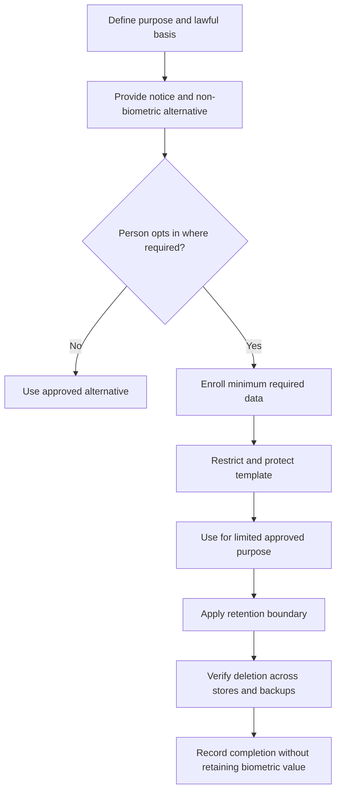

# 🛡️ Biometric data privacy

## Why this data is sensitive

A face embedding is a numerical representation derived from a person's face. It can be used to compare a new image with a stored representation. It should be treated as biometric personal data, not as anonymous technical telemetry.

Attendance timestamps and role labels can reveal an individual's schedule, location pattern, study/work behavior, and presence history.

## Data inventory

| Data | Purpose in prototype | Sensitivity | Current store |
|---|---|---|---|
| Camera frame | Face detection and embedding | Very high | In-memory frame callback |
| Face embedding | Matching a detected face | Very high | Temporary text file then Redis hash |
| Name and role | Identify registered record | Personal | Redis hash field |
| Observation timestamp | Record recognition event | Personal/behavioral | Redis list |
| Auth username/email | Operator login | Personal/account | YAML config |
| Cookie key | Sign authentication cookie | Secret | YAML config |

## Required governance questions

Before use with real people, the responsible organization must answer:
- What specific purpose requires face recognition?
- What lawful basis applies in the relevant jurisdiction?
- Is consent genuinely informed, freely given, revocable, and recorded where required?
- What non-biometric alternative is available without penalty?
- Who can enroll, view, correct, export, or delete data?
- How is the system tested for false matches and disparate error rates?
- How long are vectors, events, backups, and logs retained?
- How are requests for access, correction, deletion, and withdrawal fulfilled?
- What happens during a breach or incorrect attendance event?

This document is an engineering checklist, not legal advice. Obtain qualified legal/privacy review.

## Data minimization recommendations

- Do not retain raw camera frames unless there is a separately approved need.
- Store the minimum identity attributes required.
- Separate identity mapping from biometric templates.
- Prefer pseudonymous subject IDs in event records.
- Do not store raw embeddings in application logs.
- Apply TTL/retention rules to attendance and biometric keys.
- Include backups, replicas, exports, temporary files, and caches in deletion workflows.
- Keep development/test data synthetic.

## Lifecycle model

## Incident response

Treat unauthorized access, disclosure, loss, or misuse of embeddings and attendance histories as a high-priority privacy/security incident. Preserve necessary evidence securely, restrict access, notify responsible privacy/security owners, follow applicable notification obligations, and do not post biometric samples in public issue trackers.
