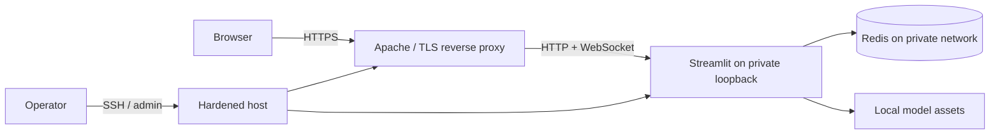

# 🚀 Deployment and hosting

## Deployment posture

The repository includes `configure.sh`, which writes an Apache virtual-host configuration intended to reverse proxy HTTP traffic to a local Streamlit process on port 8501, including a WebSocket route for `/_stcore`. It uses Debian-style snake-oil certificate paths and placeholder domain values. This is an example, not a production-ready deployment manifest.

No Dockerfile, Compose file, systemd unit, Kubernetes manifest, or tested CI deployment pipeline is present in the inspected tree.

## Recommended topology

## Pre-deployment checklist

### Application and host
- Run under a dedicated unprivileged service account.
- Bind Streamlit to loopback or a private interface behind the proxy.
- Patch OS, Python, OpenSSL, and application dependencies.
- Use pinned and reviewed dependencies.
- Restrict inbound network traffic.
- Configure process supervision, restart behavior, and resource limits.
- Verify model files are from a trusted source and match documented checksums.

### Reverse proxy
- Replace placeholder domain and certificate paths.
- Use a trusted TLS certificate and automated renewal.
- Preserve the host header and proxy WebSocket traffic.
- Set upload/body/time limits appropriate for the app.
- Apply security headers where compatible.
- Restrict access using institutional identity controls where possible.

### Redis
- Do not expose Redis publicly.
- Use TLS, ACLs, authentication, and least privilege.
- Separate environments and prevent test/prod cross-use.
- Configure retention, backup encryption, restore tests, and deletion propagation.

### Biometric governance
- Approve purpose, lawful basis, consent, and alternative attendance method.
- Complete a privacy impact assessment.
- Restrict registration, lookup, report, correction, and export permissions.
- Define incident response and individual rights workflows.
- Review model performance, false matches, and spoofing risks.

## Apache configuration notes

The existing `configure.sh` writes a virtual host file to `/etc/apache2/sites-available/deploy_attendance_app.conf`. It does not enable the site, validate Apache syntax, install a certificate, or configure Streamlit. It uses shell redirection and placeholder values. Review the file and replace the deployment approach with a managed configuration process before use.

## Deployment verification

- `apachectl configtest` passes.
- HTTPS certificate and renewal work.
- Streamlit UI and WebSocket transport work through the proxy.
- Redis is reachable only from the application network.
- Authentication works and session cookies are protected.
- Health and resource monitoring are active.
- No secret or biometric record is printed to logs.
- Restore and deletion procedures have been tested.
