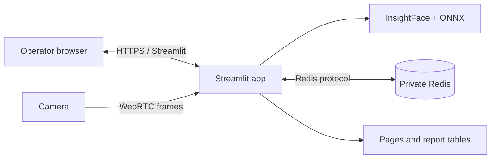
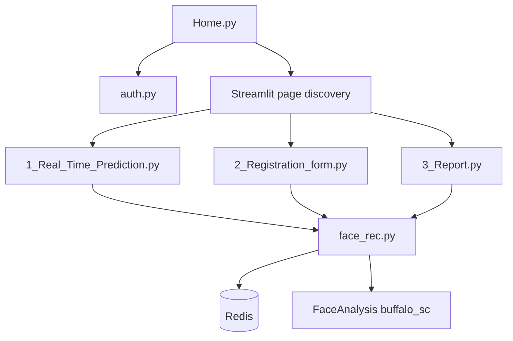
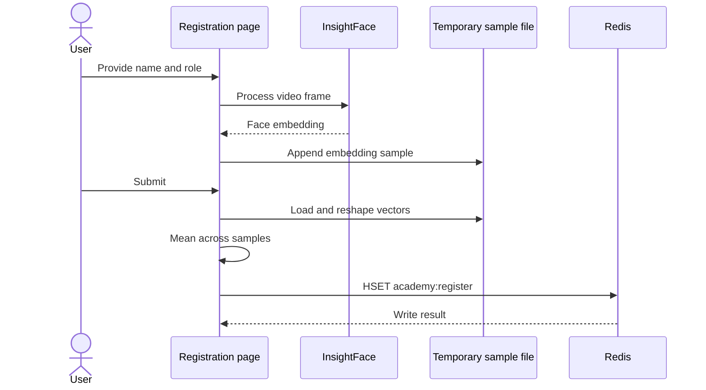
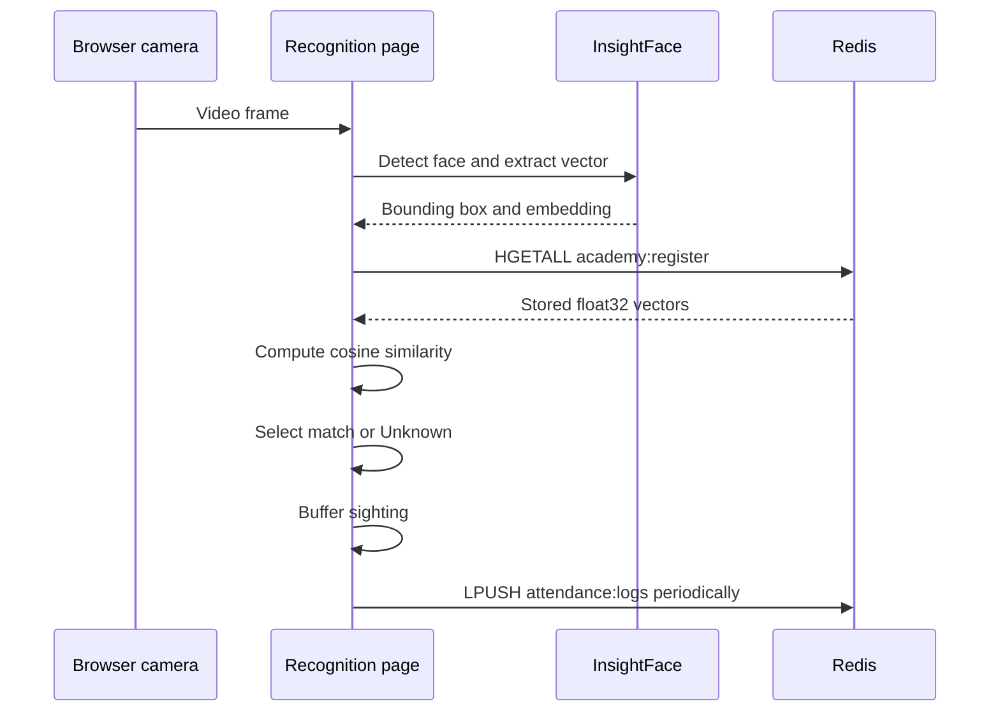
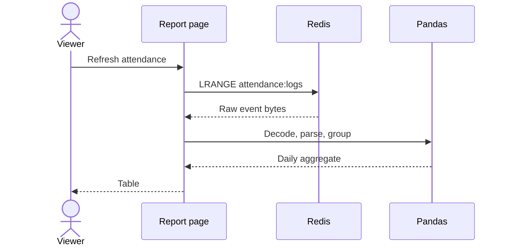
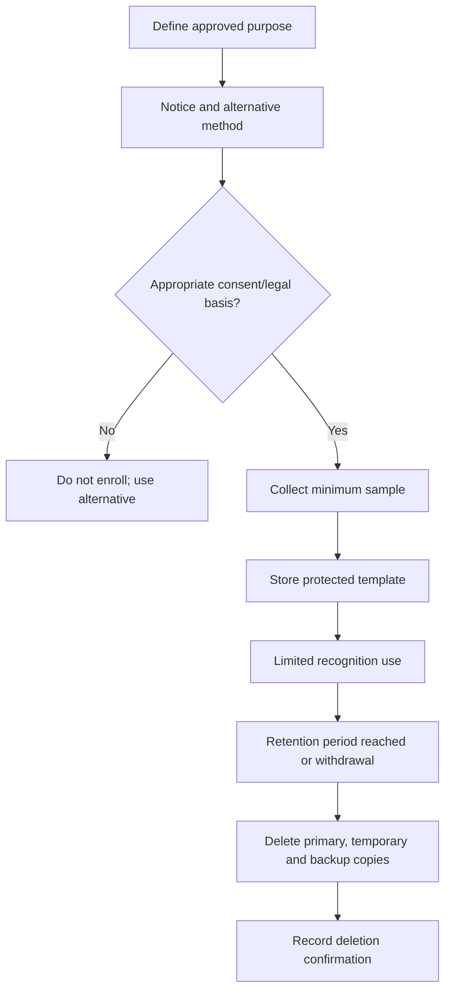
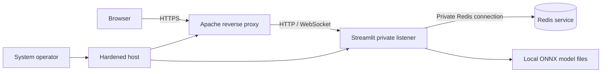
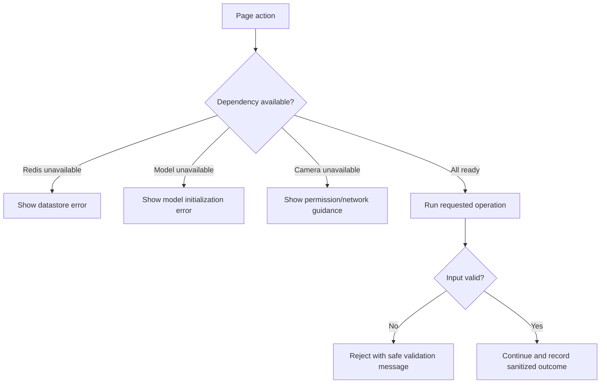

# 🔁 System flow diagrams

## 1. System context

## 2. Runtime components

## 3. Registration sequence

## 4. Recognition sequence

## 5. Reporting sequence

## 6. Biometric data lifecycle

## 7. Deployment topology

## 8. Failure boundaries

## Diagram maintenance

These diagrams describe current architecture at a conceptual level or a clearly labeled target lifecycle. They do not prove that all source paths work. Keep known defects linked from [known issues](../known-issues.md).
